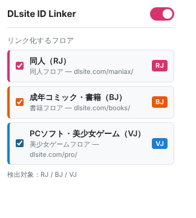

# DLsite ID Linker

閲覧中の Web ページ内のテキストから DLsite の作品番号（`RJ123456` / `BJ01234567` など）を検出し、
DLsite の作品ページへのリンクに自動で変換する Chrome 拡張機能（Manifest V3）です。
どの販売部門（フロア）の番号をリンク化するかはポップアップで切り替えられます。



## 機能

- 有効な部門の接頭辞＋6桁または8桁の数字を検出してリンク化（新しいタブで開く）
- 小文字（`rj123456`）も検出し、リンク先では大文字に正規化
- 前後が英数字に接しているもの（`XRJ123456`、`RJ1234567890` など）は対象外
- フロアごとに下線の色を変えて区別（同人＝ピンク、書籍＝オレンジ、PCソフト＝青）
- 無限スクロールや SPA など、後から追加されたコンテンツにも対応（MutationObserver＋デバウンス）
- 設定を変更すると、開いているタブにすぐ反映（OFF にした部門のリンクは元のテキストに戻る）
- dlsite.com 上では動作しません

### 初期設定の部門

| 部門ID | 表示名 | 接頭辞 | フロア | リンク先 |
|---|---|---|---|---|
| doujin | 同人 | RJ | maniax | `https://www.dlsite.com/maniax/work/=/product_id/{ID}.html` |
| books | 成年コミック・書籍 | BJ | books | `https://www.dlsite.com/books/work/=/product_id/{ID}.html` |
| pcsoft | PCソフト・美少女ゲーム | VJ | pro | `https://www.dlsite.com/pro/work/=/product_id/{ID}.html` |

初期状態では「同人（RJ）」だけが有効です。

### 変換しない場所

- すでに `<a>` タグ内にあるテキスト
- `input` / `textarea` / `script` / `style` / `noscript` / `code` / `pre` / `contenteditable` の中
- 拡張機能自身が生成したリンク（`a.dlsite-id-link`）の中
- `title` / `select` / `option` / `template` / `svg` / `math` の中（リンクを置いても機能しないため）

## インストール手順

1. このリポジトリをダウンロードする
   - `git clone https://github.com/<ユーザー名>/dlsite-id-linker.git`
   - または GitHub の「Code」→「Download ZIP」で取得して展開する
2. Chrome で `chrome://extensions` を開く
3. 右上の「デベロッパー モード」をオンにする
4. 「パッケージ化されていない拡張機能を読み込む」をクリックし、`manifest.json` があるフォルダを選ぶ
5. ツールバーのパズルアイコンから「DLsite ID Linker」をピン留めすると、設定を開きやすくなります

ファイルを更新したときは、`chrome://extensions` で拡張機能の再読み込みボタンを押してから、対象のページを再読み込みしてください。

## 使い方

拡張機能アイコンをクリックするとポップアップが開きます。

- 右上のスイッチ：拡張機能全体の ON / OFF
- 部門ごとのチェックボックス：その部門の番号をリンク化するかどうか

設定は `chrome.storage.sync` に保存され、同じ Google アカウントの Chrome 間で同期されます。

## 動作確認（テストページ）

`test/test.html` に、各部門の番号・検出すべきケース・変換してはいけないケース・動的追加のケースをまとめています。
各行に期待値があり、ページ上で自動的に ✓ / ✗ を判定します。

ローカルファイル（`file://`）では拡張機能はそのままでは動きません。次のどちらかで開いてください。

- **ローカルサーバーで開く（おすすめ）**
  ```sh
  cd test
  python3 -m http.server 8000
  # → http://localhost:8000/test.html を開く
  ```
- **file:// で開く**：`chrome://extensions` → DLsite ID Linker の「詳細」→「ファイルの URL へのアクセスを許可する」をオンにしてから `test/test.html` を開く

テストページ上部のチェックボックスを、ポップアップでの部門設定と同じ状態にすると判定が一致します。
「3. 動的に追加されるコンテンツ」のボタンで、MutationObserver の動作と無限ループが起きていないこと（DOM 変更回数が増え続けないこと）を確認できます。

## 部門を追加・変更する方法

部門の定義は **`src/departments.js` の `DLSITE_DEPARTMENTS` だけ**にあります。
検出用の正規表現・リンク生成・ポップアップの項目・初期設定は、すべてこの配列から作られるので、ほかのファイルを触る必要はありません。

### 部門を追加する

`DLSITE_DEPARTMENTS` に要素を1つ追加します。たとえば、架空の接頭辞 `XJ` の部門なら次のようにします。

```js
Object.freeze({
  id: 'example',            // 部門ID（英数字。設定の保存キーになるので後から変えない）
  label: '例の部門',          // ポップアップに出る表示名 →「例の部門（XJ）」
  prefix: 'XJ',             // 接頭辞（英字2文字、大文字で書く）
  floor: 'example',         // DLsite のフロア識別子（URL のパス）
  floorLabel: '例のフロア',    // ポップアップに出るフロア名
  color: '#2f9e44',         // フロアを区別する色（バッジ・下線）
  urlTemplate: 'https://www.dlsite.com/example/work/=/product_id/{ID}.html',
  defaultEnabled: false,    // 初期状態で有効にするか
}),
```

保存したら `chrome://extensions` で拡張機能を再読み込みしてください。
すでに設定を保存している環境では、新しい部門は `defaultEnabled` の値で補完されます。

### リンク先 URL を変更する

該当部門の `urlTemplate` を書き換えます。`{ID}` は大文字に正規化した作品番号（例：`RJ123456`）に置き換わります。

### 数字の桁数を変更する

`src/departments.js` の `DLSITE_ID_DIGIT_LENGTHS`（初期値 `[8, 6]`）を変更します。長い順に並べてください。

### 注意

- `id` は設定の保存キーなので、変更すると既存のユーザー設定は引き継がれず `defaultEnabled` に戻ります。
- `content.js` の `SKIP_TAGS` を編集すると、変換しない要素を増減できます。

## ファイル構成

```
dlsite-id-linker/
├── manifest.json        # MV3 マニフェスト（content script は <all_urls>、dlsite.com は除外）
├── src/
│   ├── departments.js   # 部門定義と、正規表現・URL 生成のヘルパー
│   ├── storage.js       # chrome.storage.sync の読み書き
│   ├── content.js       # 検出・リンク化・復元・MutationObserver
│   └── content.css      # リンクのスタイル
├── popup/               # ポップアップ（設定画面）
│   ├── popup.html
│   ├── popup.css
│   └── popup.js
├── icons/               # アイコン（16 / 32 / 48 / 128px）
├── test/test.html       # 動作確認用ページ
└── docs/popup.png       # README 用スクリーンショット
```

## 実装メモ

- テキストノードの走査には `TreeWalker` を使い、変換対象外の要素は子孫ごと読み飛ばします。
- DOM は `createElement` / `createTextNode` だけで組み立て、`innerHTML` は使いません。
- 自分で DOM を変更するときは MutationObserver をいったん `disconnect` し、変更後に `observe` し直すので、自分の変更で再び処理が走ることはありません。
- 一度に大量のノードが追加された場合は、個別処理をやめて body 全体を1回だけ再走査します。
- 部門を OFF にしたときは、リンクを元のテキストノードに戻し、前後のテキストノードと結合します。
